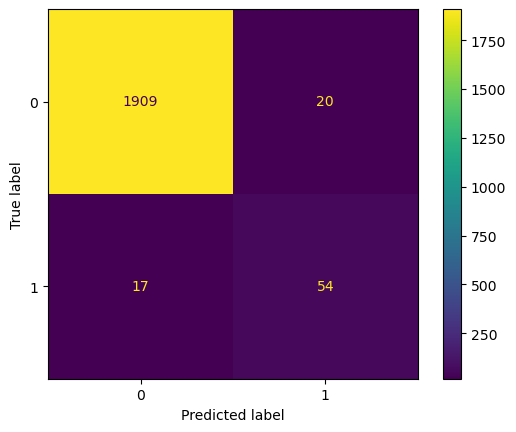
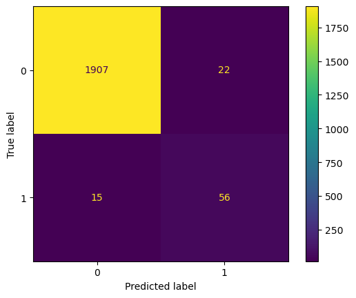
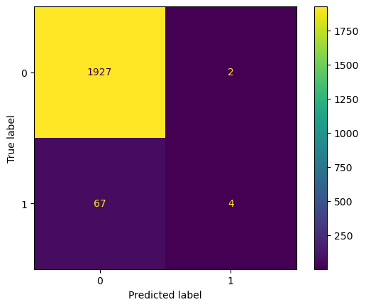

# UC Berkeley ML-AI-Cert - Capstone Project
# Detecting fraud in Agentic Payments - Final Report
Paul Beare - October 2026

## Project files

- [Notebook: UCB_MLAI_Capstone_workbook_PB.ipynb](UCB_MLAI_Capstone_workbook_PB.ipynb)
- [Dataset Generator Program: generate_10k_agentic_payments_transactions_with_fraud_network_info_and_statistical_noise.ipynb](data/generate_10k_agentic_payments_transactions_with_fraud_network_info_and_statistical_noise.ipynb)
- [Generated Dataset: noisy_agentic_payments_10k.csv](data/noisy_agentic_payments_10k.csv)

## Problem presented
Machine Learning (ML) has long been used in detecting digital payment fraud for “Traditional Digital Payments” (e.g. online purchases, merchant POS purchases, etc.) in which a human was part in real time of each payment transaction.
As we transition to service providers and merchants offering and accepting payments driven by autonomous Payment Agents, new strategies, data sources and ML/AI algorithms need to be developed and implemented.

Some the key benefits in using ML for fraud detection in Agentic Payments are:

• Real-Time Millisecond Interventions
Agentic and ML-driven payment flows operate at lightning speed to analyze hundreds of data points per transaction. They neutralize threats and block suspicious transfers before funds settle, closing the window of opportunity that fraudsters exploit.

• Dynamic Pattern Recognition & Contextual Awareness
Unlike rigid, static rule-based systems that miss novel schemes, ML models correlate data across multiple silos—including user behavior, device reputation, merchant signals, network speed, and historical baselines—to spot subtle, distributed fraud strategies.

• Drastic Reduction in False Positives
Traditional filters frequently overreact to unusual but legitimate purchases, frustrating customers and burdening human reviewers. ML risk-scoring prioritizes true threats, cutting false-positive rates dramatically while keeping legitimate checkouts smooth.

• Adaptive Learning Against Evolving Tactics
Fraudsters constantly shift their techniques. ML models continuously incorporate feedback loops, retrain on fresh data signals, and adapt their scoring thresholds on the fly to catch emerging topologies.

• Autonomous Investigation & Goal-Oriented Orchestration
Moving past simple anomaly scoring, agentic AI can automate the investigative workflow itself: it traces money flows, maps connected accounts or shared IP/device clusters using graph analytics, and decides whether to approve an action or dynamically trigger step-up biometric verification.

• Full Explainability & Regulatory Compliance
Modern agentic systems generate transparent, human-readable rationales behind every risk score or blocked action. This provides the auditable paper trail required by financial regulators without drowning compliance teams in raw alerts

The model in this project could be useful for a payment processor, also called "acquirers" when it decides to begin accepting Agentic Payments in addition to the customary eCommerce or "card present" payments.

## Model outcomes or Predictions
Agentic Payments are similar to typical digital payments transactions, in the sense that each transaction is represented by a record which contains the Amount of the payment to be made, the date and time, and several additional fields which add context, security, networking, geographical, merchant information, etc.  However, for Agentic Payments we have new and different data points such as descriptions of the Agentic protocol used, the Agent provider, the Agent Type, the mandate signature validation, etc.  All these additional fields could add information which when analyzed massively with a ML model could increase the chance of detecting a fraudulent transaction before it is sent to the payment processor for final accreditation.

We envision two types of outcomes or "predictions" once a dataset has been selected.  One is the probability that a specific transaction is fraud, expressed from 0% to 100%, and then let the system administrator  decide dynamically what the threshold of risk she wishes to take.  This would be a Linear Regression type of model, in which the outcome is any number between 0 and 1.  The second type of model would be Classification type of model in which the outcome would be one of two options, for example 0 for non-fraudulent transaction or 1 for anomalous or suspected fraudulent transactions, or rather False or True.

In our exercise we have decided to generate data that would result in a binary outcome of 0 or 1, and we called that field the Is_Anomalous_Fraud field.

## Data acquisition
Real-world agentic payment datasets are scarce because financial transactions involve strict privacy regulations, high security risks, and proprietary banking infrastructure. Furthermore, autonomous AI agents executing financial transactions represent an emerging paradigm, meaning few large-scale production logs or real-world interaction histories exist yet.
Because collecting and labeling live financial data is costly, legally restricted, and exposes sensitive account details, and we were not able to find publicly available agentic payments sample datasets, we used AI to create an algorithmic generator to artificially construct safe, compliant training data.  The Python program that we used, analyzed and then analyzed the results creates 10.000 records of simulated data with a simulated fraud rate of 3.2% of the transactions.

The columns worthy of special mention of the data generated had the following name and short descriptions as related to Agentic Payments:

Agent_Name:  name of the Agent which decided to request the payment
Agent_Type:  type of Agent, for example: SaaS / Bills / API / Infrastructure / Inventory Supply / DeFi / Investment / Marketing
Trigger_Reason:  the type of trigger which was actuated and generated the decision to initiate the payment
Technical data:  such as Originating IP, API used, Server region, Payment Rail are additional technical info of the transaction

## Data pre-processing / preparation
Since the data was generated by a program, our first step was to understand exactly how the program worked, and how the program added statistical noise to the determination of fraud in order to avoid the generation of highly correlated fields.  Once we understood the program and decided that the logic was reasonable and that no model would to be able to learn perfectly the algorithm, we ran the program and generated a .CSV (comma separated values) file with 10.000 records.

Next, we used a Jupyter Notebook to load the data, convert it into a Pandas dataframe, and begun analyzing the data to decide which rows and columns were not needed and could be eliminated.  Since this is not real world data and each row was generated programatically, there were no missing values, so no rows had to be eliminated.  However, this would not happen with real world datasets, and much more work would be needed in order to select, clean and prepare the data.  But we did need to eliminate some of the columns that would not add any particular value to the analysis and would only slow down and increase the computational cost of the running of all our models. 

We also used several visualizations of the Matplotlib library to get a feeling with respect to which columns (features) had more or less importance in the determination of fraudulent transactions.

In order to be able to find out and compare the strenghts of all our models, we first split the data into training and testing (development) sets.  For this we used the train_test_split function in the sklearn.model_selection library.

Since most of the data, except for the Amount field and the Fraud field contained text, or non-numeric content, and ML cannot handle text, we first needed to encode all the data using the One Hot Encoding mechanism.  This results in a sort of "bitmap" which shows for each row, if a certain token or text is present in that row (shown with a 1) or not (shown with a 0).

## Modeling
Since this is a classification problem, in which the model needs to learn from rows which determine if it was fraud (1) or not-fraud (0), we will not be able to use Linear Regression as a model.  In advance we cannot know which model will perform best, so we decided to try several models and compare the results.  The models we decided to use are:  Logistic Regression, Decision Tree, Random Forest, and SVC.  In the case of Random Forest Classifier we also evaluated different hyperparameters in order to find the parameters which result in the best performance of the model.  
To measure the performance of each model we compared Accuracy, Precision, Recall and F1 Score.  Since this is an imbalanced model because only a small (3.2%) of the transactions fell in the target (i.e. are fraudulent), we decide to try generating a more balanced dataset using the SMOTE (Synthetic Minority Over-sampling Technique) to see if the performance would improve.  Also, since this an imbalanced dataset Accuracy is a poor metric because it rewards the model for simply guessing the majority class, probably hiding the fact that it completely fails to detect the minority class.  Recall and F1 scores help us better decide which is the best model to use.

## Summary of findings

Without knowing the expected results we advance, we tried the different models, or variations of models, and the result was that the results improved after each new model, except for the final model used (SVC) in which the results were the worst of all.

Below we show the table we generated in our Jupyter Notebook, which clearly shows that the best results were achieved by the SMOTE Random Forest model, and the worst were achieved by the SVC model.  After the table, we show the confusion model of each of the models, and the explanation of the results obtained for each.

For this type of problem, the F1 score provides the best guide as which is the best model since if provides a harmonic mean of precision and recall in a single value.  A score of 0.8 as shown for the best performing model can be considered a strong model with a healthy balance of precision and recall.

| Model | Accuracy | Precision | Recall | F1 Score |
|---|---:|---:|---:|---:|
| Logistic Regression | 0.9760 | 0.701754 | 0.563380 | 0.625000 |
| Decision Tree | 0.9785 | 0.725806 | 0.633803 | 0.676692 |
| Random Forest | 0.9815 | 0.729730 | 0.760563 | 0.744828 |
| Grid Search Decision Tree | 0.9815 | 0.717949 | 0.788732 | 0.751678 |
| SMOTE Random Forest | 0.9845 | 0.738095 | 0.873239 | 0.800000 |
| SVC | 0.9655 | 0.666667 | 0.056338 | 0.103896 |

### Logistic Regression
Of the 2000 transactions of the Test set, 71 were actually fraud, but only 40 were correctly predicted.

### Decision Tree
Of the 2000 transactions of the Test set, 71 were actually fraud,  45 were correctly predicted, a small improvement.

### Random Forest
Of the 2000 transactions of the Test set, 71 were actually fraud, but now 54 (a significant improvement) was achieved.

### Random Forest with Hyperparameter selection
Using GridSearchCV to try different hyperparameters resulted in an increase to 56 correctly selected.

### Random Forest with SMOTE
Finally, the best results are achieved after balancing the dataset using SMOTE, and 62 fraudulent transactions are correctly determined.

### Support Vector Classifier

Running one additional model proved that SVC would not work well for this dataset.  SVC struggles with extreme class imbalance because its objective is to maximize the margin around a decision boundary, frequently causing it to ignore the minority (fraud) class and bias heavily toward the majority (legitimate) class.  Only 4 of the 71 were correctly identified as fraud.

## Conclusions

1) This Project serves as an important advance to understand the application of Machine Learning algorithms to the detection of fraud in Agentic Payment transactions.
2) Working with generated synthetic data is not as useful or challenging as doing it with real world data, but for the reasons exposed above it was our only option for this project.
3) As a new and evolving technology, many more data sources could be used to complement the data examples used in this project, in particular the data sources related to the Agentic Commerce transaction, i.e. the data points related to the products or services purchased, merchant information, customer information, purchase history, customer address, etc. to make the process of identifying fraud much more complete and powerful.  However, the underlying models to be used and findings of this project would still apply to these new scenarios.
4) Of the model and parameters tried, the best performing model resulted in the Random Forest model using SMOTE to balance the dataset, achieving the following results, much surpassing the baseline model:

Accuracy:  0.9845 
Precision: 0.738095
Recall:    0.873239 
F1 score:  0.800000

## Additional steps

Once a useful and accurate model has been selected, as in the process described above, one could place the model in production, so that it could be used in the real world with real transactions.  

To turn a trained machine learning model into a callable REST API, we should follow these core steps:

• Save the Model: Serialize our trained model into a file (such as using joblib or pickle for scikit-learn, or native save formats for PyTorch/TensorFlow).

• Build an API Application: Write a lightweight web service using a framework like FastAPI or Flask. Define a data schema (e.g., via Pydantic in FastAPI) to validate incoming request payloads.

• Create a Prediction Endpoint: Write an HTTP POST route in your app that loads the saved model, preprocesses incoming request data, runs .predict(), and returns the output as JSON.

• Containerize the Service: Write a Dockerfile that packages your Python runtime, required dependencies (requirements.txt), the API script, and the model artifact into an isolated container image.

• Deploy and Test: Run the container locally or push it to a cloud hosting platform (such as AWS, Google Cloud Run, or Render), then test your live endpoint using curl, Python requests, or the interactive Swagger docs (/docs)

----------------------- END OF README FILE ------------------------------------------